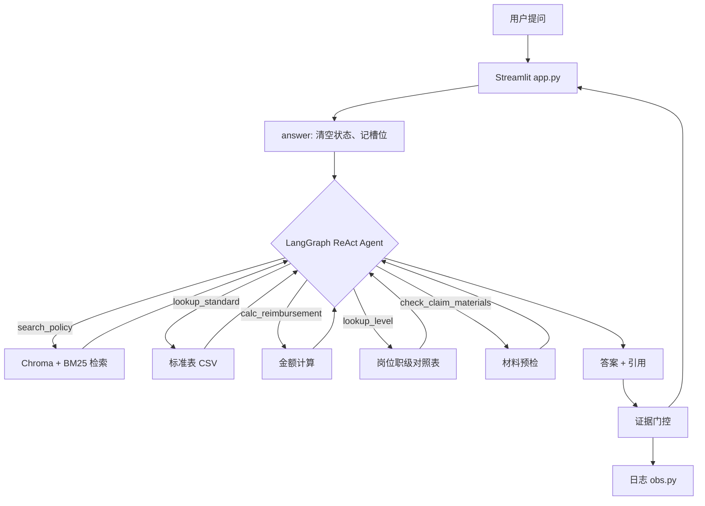

# 制度与报销智能问答

公司差旅、报销、发票制度的问答工具。基于 Chroma 检索和 DeepSeek，回答必须带条款出处，金额由代码计算，没有依据时拒答。


技术栈：Python、LangChain、LangGraph、Chroma、BM25（jieba）、Streamlit、DeepSeek、硅基流动 Embedding。

## 解决的问题

- 制度分散在 5 份文件里，员工查一条规则要翻半天；
- 差旅制度有 2024 和 2025 两个版本，金额不同，容易混用；
- 住宿、餐补、交通的限额要按职级和城市查表再算，人工容易算错。

## 示例

**问：我是 P6，去上海出差 3 晚，酒店 750 一晚，能报多少？**

```
直接回答：P6 在上海（一线）住宿上限 600 元/晚，3 晚共可报 1800 元；
         实际 750×3=2250 元，超出 450 元需自理，想报销需事前审批。
怎么操作：1. 订 600 元/晚以内；2. 若已订 750，出发前提交超标申请；
         3. 索取增值税专用发票，核对抬头与税号。
依据：标准速查表 P5-P6/一线=600；差旅制度 3.2 住宿费；4.3 超标处理。
需要确认：是否已提交超标审批？
```

**问：那 P7 呢？**

```
直接回答：P7 及以上、M 序列在上海（一线）住宿上限 800 元/晚。
```

第二问没有重复城市和天数，条件来自上一轮槽位。

**问：出差可以坐飞机头等舱吗？**

```
直接回答：制度中没有写明舱位等级标准，无法判断头等舱是否可坐，建议联系 HR 确认。
```

## 工作流程

```
data/*.md,*.csv
   │  ingest.py        条款切分、写入路径、批量入库
   ▼
storage/chroma
   │  retrieval.py     向量 + BM25 召回，RRF 融合，按版本过滤
   ▼
agent.py              模型选择工具，工具返回带编号的片段
   │
   ▼
答案 + 引用 + 决策轨迹  →  app.py（Streamlit） / obs.py（日志）
```

## 架构



## 关键设计

### 切分

按 Markdown 标题和条款号切块，不按固定字数。每个块首行写入章节路径，例如：

```
【差旅费管理制度（2025 年修订版） > 第三章 费用标准 > 3.2 住宿费】
```

路径有两个作用：让向量知道这段属于哪一条；让引用能显示条款位置。超长条款再按句号切分，避免一块过长。5 份文件共切出 45 块。

### 检索

向量召回 10 条，BM25 召回 10 条，用 RRF 按名次融合，取前 6 条交给模型。

- 向量负责语义相近的表述（「住宿怎么报」对应「住宿费标准」）；
- BM25 负责精确 token（600、P7、增值税专用发票）；
- RRF 只看排名，避免余弦分数（0~1）与 BM25 分数（0~20+）量纲不同。

`k_final=6` 来自消融实验：k=4 时 Recall 70%，k=6 时 85%，再增大收益递减、token 上升。

### 版本隔离

检索时用 metadata 做硬过滤，2024 会话只返回 2024 和通用条款。标准表只有 2025 版，在 2024 会话里查表工具会拒绝返回，提示改用制度正文，避免表格金额与正文金额冲突。

### Agent 与工具

使用 LangGraph 的 ReAct Agent，5 个工具：

| 工具 | 作用 |
|---|---|
| `search_policy` | 检索制度原文，返回带编号的片段 |
| `lookup_standard` | 按职级和城市级别查标准表 |
| `calc_reimbursement` | 计算住宿上限、实际支出、超支金额 |
| `lookup_level` | 岗位名称转职级档位 |
| `check_claim_materials` | 报销材料预检，只读 |

工具只负责查询和计算，模型负责选择工具和组织答案。金额不经过模型心算。

### 记忆

两层：

- 对话历史存在 LangGraph checkpointer 中，只把最近 6 轮送给模型；
- 职级、城市、天数、金额等条件用正则抽取成槽位，每轮以「已确认信息」注入。窗口调到 1 轮时，只要槽位里有条件，仍能正确回答。

### 引用与拒答

- 工具返回时给每个片段编号，答案中的编号会被保留并重排；
- 检索不到相关内容时回答「制度中没有写明」，不推测；
- 证据门控：答案中两位数以上的数字必须出现在工具返回里，否则按证据重写一次，仍不通过则拒答；
- 工具内部异常返回提示文本，不让整轮请求失败。

### 日志

每次问答写一行 JSON 到 `storage/logs/app.jsonl`，字段包括请求号、耗时、工具列表、引用数、是否通过门控。异常记录堆栈，界面只显示 8 位请求号。

## 技术选型

| 组件 | 选择 | 备选 | 原因 |
|---|---|---|---|
| 向量库 | Chroma | FAISS、pgvector | 自带 metadata 过滤和持久化，45 块数据量不需要独立数据库 |
| 检索 | 向量 + BM25 | 纯向量 | 金额、条款号、专票等 token 向量容易漂 |
| 融合 | RRF | 加权求和 | 两路分数量纲不同，RRF 只看名次，不用调权重 |
| Agent | LangGraph | AgentExecutor | 需要 checkpointer 做记忆、pre_model_hook 做窗口裁剪 |
| 记忆 | MemorySaver | SqliteSaver | 演示场景单进程，重启可重建；持久化留了接入点 |
| 界面 | Streamlit | React | 单文件可跑，适合验证效果；不足是没有登录和并发能力 |

## 实现中遇到的问题

| 问题 | 现象 | 处理 |
|---|---|---|
| 窗口裁剪切断工具消息 | 报 400 `tool message must be a response to a preceding message with tool_calls` | 裁剪时按 human 消息边界切，保证 AI 的 tool_calls 与工具返回成对 |
| 中文分词不完整 | 「到账」被切成「到 / 账」，BM25 匹配不到制度里的词 | 靠向量召回和低分时的 query 改写兜底；彻底解决需要加自定义词典 |
| sqlite 只读 | 报 `attempt to write a readonly database` | 检查目录权限；必要时用 `CHROMA_DIR` 换到英文无空格路径 |
| k 值偏小 | k=4 时 Recall 只有 70% | 消融后改为 k=6，Recall 85% |

## 快速开始

```bash
python -m venv .venv
.venv\Scripts\activate            # macOS/Linux: source .venv/bin/activate
pip install -r requirements.txt

copy .env.example .env            # 填入两个 Key
python check_env.py               # 环境自检
python ingest.py                  # 建库
python eval.py                    # 检索评测
streamlit run app.py
```

## 配置

`.env` 中的主要变量：

| 变量 | 说明 |
|---|---|
| `DEEPSEEK_API_KEY` | 对话模型 Key |
| `SILICONFLOW_API_KEY` | Embedding Key |
| `LLM_MODEL` | 模型名，默认 `deepseek-flash` |
| `EMB_MODEL` | 向量模型，默认 `Qwen/Qwen3-Embedding-0.6B` |
| `HISTORY_TURNS` | 送入模型的对话轮数，默认 6 |
| `CHROMA_DIR` | 向量库路径，默认 `storage/chroma` |

## 数据与评测

- 语料：5 份文件（两版差旅制度、发票规定、报销流程、标准表），共 45 块；
- 评测集：30 条，20 条可答 + 10 条不可答；
- 检索：`Recall@6 = 85%`（17/20）；
- 消融：向量单路 65%、加 BM25 70%、k=6 85%；
- 回归：`smoke_test.py` 共 64 项，覆盖建库、切分、检索、工具、记忆、门控、日志。

```bash
python eval.py            # 检索指标，不调对话模型
python eval.py --full     # 端到端，额外测拒答与关键数字
python ablation.py        # 参数对比
python smoke_test.py      # 功能回归
```

## 目录

```
skeleton/
├── config.py       参数配置
├── llm.py          模型客户端
├── ingest.py       切分与入库
├── retrieval.py    混合检索
├── agent.py        Agent、工具、记忆、门控
├── app.py          Streamlit 界面
├── obs.py          日志
├── eval.py         检索与端到端评测
├── ablation.py     消融实验
├── smoke_test.py   回归测试
├── eval_set.jsonl  评测集
└── data/           语料
```

## 已知限制

- 单用户：会话状态是全局的，并发请求会互相覆盖；
- 记忆在进程内，重启后清空；
- 评测集 30 条，由本人编写，只能看相对变化；
- 引用只保证来自真实片段，没有逐句校验引用是否支持结论；
- 不提供提交功能，报销单仍需在 OA 中提交；
- 仅支持 Markdown、CSV、XLSX，PDF 需要额外解析。

## 后续计划

- 逐句校验引用是否支持结论，补上 groundedness；
- 记忆改用 SqliteSaver，跨重启保留；
- 评测集扩到 100 条，加入引用准确率和人工抽检；
- 按岗位/部门做权限过滤。

## 常见问题

| 现象 | 处理 |
|---|---|
| 换 embedding 模型后报维度不匹配 | 删除 `storage/`，重新 `python ingest.py --force` |
| 报模型不存在 | 确认 `LLM_MODEL` 与账号中的模型名一致（`deepseek-flash` / `deepseek-chat`） |
| 报 `readonly database` | 检查 `storage/` 权限，或在 `.env` 用 `CHROMA_DIR` 指向英文无空格路径 |
| 检索结果为空 | 确认已执行 `ingest.py`，并检查版本是否过滤掉了内容 |

## License

MIT，见 [LICENSE](LICENSE)。
